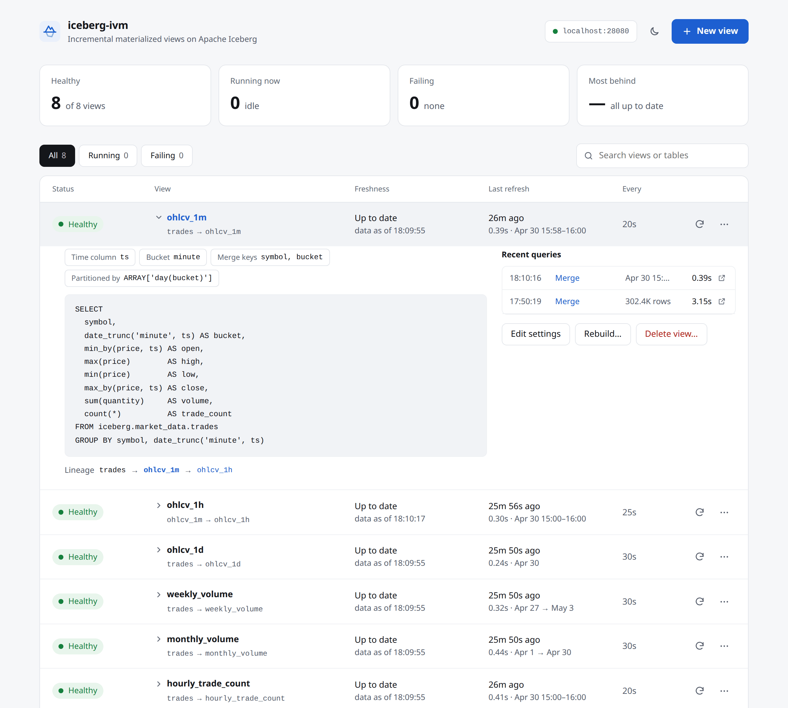
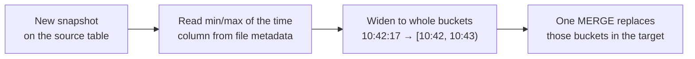

<p align="center">
  
</p>

<h1 align="center">iceberg-ivm</h1>

<p align="center">
  <b>Incremental materialized views for Trino on Apache Iceberg.</b><br>
  Write a <code>GROUP BY</code> query. iceberg-ivm keeps its result table up to date<br>
  by recomputing only the time buckets that new data touched.
</p>

<p align="center">
  <a href="https://github.com/jonasbrami/iceberg-ivm/actions/workflows/ci.yml"></a>
  <a href="https://github.com/jonasbrami/iceberg-ivm/pkgs/container/iceberg-ivm"></a>
  
  <a href="LICENSE"></a>
</p>

<p align="center">
  <picture>
    <source media="(prefers-color-scheme: dark)" srcset="docs/screenshots/dashboard-dark.png">
    
  </picture>
</p>

---

Trino can refresh a materialized view incrementally only when the query doesn't aggregate. Add a `GROUP BY` and every refresh recomputes the whole table ([trinodb/trino#18673](https://github.com/trinodb/trino/issues/18673), still open in Trino 484). iceberg-ivm fills that gap without a new engine:

- **Any aggregate.** It recomputes whole buckets from source rows, so `min_by`, `max_by`, `approx_percentile` and `count(DISTINCT …)` work, not only sums and counts.
- **Exact.** Each refresh makes the affected time range of the target equal to the query, in one atomic `MERGE`: new groups are inserted, changed groups updated, and vanished groups deleted.
- **Driven by Iceberg metadata.** It notices new snapshots and reads the min/max of the time column from file statistics, so it never scans data to find out what changed. Compaction costs nothing.
- **Chainable.** A view's target is a plain Iceberg table, so it can be the source of the next view: trades → 1-minute bars → 1-hour bars.
- **Small.** One Python service that sends SQL to Trino. Trino does all the work; the service keeps a bookmark per view in SQLite.

## Try it in two minutes

```bash
git clone https://github.com/jonasbrami/iceberg-ivm
cd iceberg-ivm/quickstart
docker compose up -d
```

Open **http://localhost:8001**. You get Trino, an Iceberg catalog, 30 days of sample trades and eight views, including a chained one. The [quickstart guide](quickstart/README.md) shows how to insert a trade and watch only the affected bars refresh.

## How it works



Say a trade for AAPL lands at `10:42:17`. On its next check (every 60 seconds by default), the 1-minute view sees a new Iceberg snapshot. It reads the time range of the new files from metadata, then recomputes the 10:42 minute, for every symbol, from the source. It replaces that minute in the target and moves its bookmark. The chained 1-hour view then sees a new snapshot on the 1-minute table and recomputes the 10:00 hour the same way.

Recomputing whole buckets from source data is what keeps non-additive aggregates correct. Every chunk of a refresh reads the source `FOR VERSION AS OF` one pinned snapshot, so a long backfill never mixes old and new data, and a restart resumes from the last committed chunk.

The [deep dive](docs/how-it-works.md) covers snapshot handling, the exact `MERGE`, backfills and the design choices.

## Define a view

A view is the query you would put after `CREATE MATERIALIZED VIEW … AS`, plus the table to write to:

```yaml
# views.yaml
views:
  - name: ohlcv_1m
    target_table: iceberg.analytics.ohlcv_1m
    target_partitioning: "ARRAY['day(minute)']"
    query: |
      SELECT date_trunc('minute', ts) AS minute,
             symbol,
             min_by(price, ts) AS open,
             max(price)        AS high,
             min(price)        AS low,
             max_by(price, ts) AS close,
             sum(quantity)     AS volume
      FROM iceberg.market_data.trades
      GROUP BY 1, 2
```

From the query, iceberg-ivm works out the source table (`trades`), the time column (`ts`), the bucket size (`minute`) and the merge keys (`minute, symbol`). The target table is created on the first refresh.

The rules:

- ✅ One Iceberg source table, with any `WHERE` and `HAVING`
- ✅ A `date_trunc('<unit>', <time column>)` bucket that is selected and in the `GROUP BY` (units: `millisecond` to `year`)
- ✅ Any aggregate; every computed column has an alias
- ❌ Joins, subqueries, CTEs, `UNION`, `LIMIT`, window functions
- ❌ A query whose `GROUP BY` has no time bucket. Without one, each refresh would overwrite all-time totals with totals for just the new rows, so it's rejected with an explanation.

You can also create views from the UI. It checks the query as you type and shows what it derived. The UI works offline (no CDNs) and follows your system's light or dark theme.

## Run it on your Trino

```yaml
# docker-compose.yml
services:
  iceberg-ivm:
    image: ghcr.io/jonasbrami/iceberg-ivm:latest
    environment:
      TRINO_URL: https://trino.example.com:8443
      TRINO_USER: iceberg-ivm
      TRINO_PASSWORD: ${TRINO_PASSWORD}
      IVM_PASSWORD: ${IVM_PASSWORD}  # protects the UI and API
    volumes:
      - ./ivm:/data  # config.yaml and views.yaml; state.db is written here
    command: ["-c", "/data/config.yaml", "--views", "/data/views.yaml"]
    ports:
      - "8000:8000"
```

```yaml
# ivm/config.yaml
trino:
  catalog: iceberg    # used for names that aren't fully qualified
  schema: analytics
```

`docker compose up -d`, then open http://localhost:8000. Views added in the UI are written back to `views.yaml`, and edits to the file are picked up within 30 seconds.

| Environment variable | | |
|---|---|---|
| `TRINO_URL` | required | Coordinator URL, e.g. `https://trino.example.com:8443` |
| `TRINO_USER` | required | |
| `TRINO_PASSWORD` | optional | Basic auth to Trino |
| `TRINO_PUBLIC_URL` | optional | Trino's URL as your browser sees it, for the UI's query links |
| `IVM_PASSWORD` | optional | Requires this password (HTTP Basic, any user name) for the UI and API. `/health` and `/metrics` stay open. |

The Trino user needs `SELECT` on sources, `CREATE TABLE` in the target schema, and `INSERT`, `UPDATE` and `DELETE` on targets (for `MERGE`). Maintenance needs `ALTER TABLE … EXECUTE`.

## View settings

| Setting | Default | |
|---|---|---|
| `query` | required | The view's `SELECT` |
| `target_table` | required | Where results go. Created if missing. |
| `name` | `target_table` | Label in the UI, API and metrics |
| `target_partitioning` | none | Iceberg partitioning for a new target, e.g. `"ARRAY['day(minute)']"`. Partitioning by the bucket keeps refreshes fast. |
| `refresh_interval_seconds` | `60` | How often to check the source for new snapshots |
| `query_timeout_seconds` | none | Cancels a refresh (and its Trino queries) that runs longer |
| `full_refresh_chunk` | none | Backfill in chunks (`hour` … `year`), each committed separately and resumable. Large catch-ups are chunked too. |
| `maintenance_interval_seconds` | `0` (off) | Run Iceberg maintenance on the target at most this often |
| `optimize`, `expire_snapshots`, `remove_orphan_files` | `true` | Which maintenance operations run |
| `optimize_file_size_threshold` | Trino's | e.g. `"128MB"` |
| `expire_snapshots_retention`, `remove_orphan_files_retention` | `"7d"` | |

## Operate it

| Task | How |
|---|---|
| Refresh now | **Refresh** in the UI, or `POST /api/views/{name}/refresh` |
| Recompute everything | `POST /api/views/{name}/rebuild`. The target stays readable while it runs. |
| Change settings | Edit `views.yaml`, the UI, or `PUT /api/views/{name}`. To change a query, delete the view and create it again. |
| Delete a view | `DELETE /api/views/{name}`. The target table is kept; drop it yourself if you want the data gone. |
| Restart or upgrade | Safe at any time. A run interrupted mid-backfill resumes from its last committed chunk. |

**Keep `state.db` on a persistent volume.** It holds each view's bookmark. Without it, every view rebuilds from scratch on the next start.

**Run one instance per set of target tables.** Two instances would race on the same `MERGE`s.

**Watch it with Prometheus** (`/metrics`, labelled by `view`):

| Alert on | Meaning |
|---|---|
| `increase(mv_refresh_errors_total[10m]) > 0` | Refreshes are failing |
| `time() - mv_refresh_last_success_timestamp > 3 * <interval>` | A view stopped advancing |
| `mv_refresh_duration_seconds` p95 growing | Refreshes are scanning more than you expect; check `target_partitioning` |

Other endpoints: `GET /api/views` (views with status), `POST /api/views` (create), `POST /api/views/parse` (check a query), `GET /health`.

## When to use something else

| If you… | Consider |
|---|---|
| …only filter and project, without `GROUP BY` | Trino's own materialized views, which refresh those incrementally |
| …already use dbt, batch hourly or coarser, and can bound late data with a lookback window | dbt-trino's `microbatch` strategy: same engine and whole-bucket recompute, run on a schedule rather than on new snapshots |
| …can add another engine, and your sources are append-only with sum/count/min/max-style aggregates | StarRocks 4.1 incremental materialized views over Iceberg (results live in StarRocks) |
| …are on Snowflake or Databricks-managed Iceberg | Dynamic tables, or Databricks materialized views |

iceberg-ivm fits when **Trino is your engine, Iceberg is your storage, and you need aggregates kept fresh within seconds or minutes of each commit**, including the ones that can't be added up from partial results.

## Limitations

- One source table per view.
- Sources need min/max statistics on the time column. Trino and Spark write them by default. If they're missing, the view falls back to a full refresh and reports an error rather than skip data.
- A source `DELETE` triggers a full refresh. An `UPDATE` must not move a row to a different time bucket.
- Sessions run in UTC, so `date_trunc` on `timestamp with time zone` buckets in UTC.
- No high availability: run a single instance.

## Contributing

Bug reports and pull requests are welcome. [CONTRIBUTING.md](CONTRIBUTING.md) covers the development setup and the test suites; [docs/how-it-works.md](docs/how-it-works.md) explains the internals.

## License

[Apache License 2.0](LICENSE)
