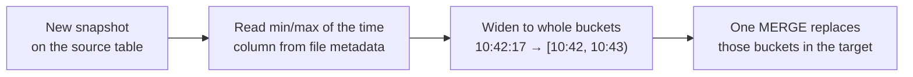

<p align="center">
  
</p>

<h1 align="center">iceberg-ivm</h1>

<p align="center">
  <b>Incremental materialized views on Apache Iceberg.</b><br>
  Write a <code>GROUP BY</code> query over an Iceberg table. iceberg-ivm keeps its result,<br>
  another Iceberg table, up to date by recomputing only the time buckets that new data touched.
</p>

<p align="center">
  <a href="https://github.com/jonasbrami/iceberg-ivm/actions/workflows/ci.yml"></a>
  <a href="https://github.com/jonasbrami/iceberg-ivm/pkgs/container/iceberg-ivm"></a>
  
  <a href="LICENSE"></a>
</p>

<p align="center">
  <picture>
    <source media="(prefers-color-scheme: dark)" srcset="docs/screenshots/dashboard-dark.png">
    
  </picture>
</p>

---

Keeping an aggregate over a growing Iceberg table fresh usually means recomputing it from scratch on a schedule, or hand-writing incremental logic that misses late data. iceberg-ivm reads Iceberg's own metadata to see exactly which rows are new, and recomputes only the buckets they fall into ([how it compares](#how-it-compares)):

- **Any aggregate.** It recomputes whole buckets from source rows, so `min_by`, `max_by`, `approx_percentile` and `count(DISTINCT …)` work, not only sums and counts.
- **Exact.** Each refresh makes the affected time range of the target equal to the query, in one atomic `MERGE`: new groups are inserted, changed groups updated, and vanished groups deleted.
- **Driven by Iceberg metadata.** It notices new snapshots and reads the min/max of the time column from file statistics, so it never scans data to find out what changed. Compaction costs nothing.
- **Chainable.** A view's target is a plain Iceberg table, so it can be the source of the next view: trades → 1-minute bars → 1-hour bars.
- **Small, and not tied to one engine.** One Python service that reads Iceberg metadata and hands SQL to a query engine, which does all the work; the service only keeps a bookmark per view in SQLite. Today that engine is Trino. The method needs nothing more than Iceberg's metadata tables, time travel and `MERGE`, so other engines such as Spark could do the same job.

## Try it in two minutes

```bash
git clone https://github.com/jonasbrami/iceberg-ivm
cd iceberg-ivm/quickstart
docker compose up -d
```

Open **http://localhost:8001**. You get Trino, an Iceberg catalog, 30 days of sample trades and eight views, including a chained one. The [quickstart guide](quickstart/README.md) shows how to insert a trade and watch only the affected bars refresh.

## How it works



Say a trade for AAPL lands at `10:42:17`. On its next check (every 60 seconds by default), the 1-minute view sees a new Iceberg snapshot. It reads the time range of the new files from metadata, then recomputes the 10:42 minute, for every symbol, from the source. It replaces that minute in the target and moves its bookmark. The chained 1-hour view then sees a new snapshot on the 1-minute table and recomputes the 10:00 hour the same way.

Recomputing whole buckets from source data is what keeps non-additive aggregates correct. Every chunk of a refresh reads the source `FOR VERSION AS OF` one pinned snapshot, so a long backfill never mixes old and new data, and a restart resumes from the last committed chunk.

The [deep dive](docs/how-it-works.md) covers snapshot handling, the exact `MERGE`, backfills and the design choices.

## Define a view

A view is the query you would put after `CREATE MATERIALIZED VIEW … AS`, plus the table to write to:

```yaml
# views.yaml
views:
  - name: ohlcv_1m
    target_table: iceberg.analytics.ohlcv_1m
    target_partitioning: "ARRAY['day(minute)']"
    query: |
      SELECT date_trunc('minute', ts) AS minute,
             symbol,
             min_by(price, ts) AS open,
             max(price)        AS high,
             min(price)        AS low,
             max_by(price, ts) AS close,
             sum(quantity)     AS volume
      FROM iceberg.market_data.trades
      GROUP BY 1, 2
```

From the query, iceberg-ivm works out the source table (`trades`), the time column (`ts`), the bucket size (`minute`) and the merge keys (`minute, symbol`). The target table is created on the first refresh.

The rules:

- ✅ One Iceberg source table, with any `WHERE` and `HAVING`
- ✅ A `date_trunc('<unit>', <time column>)` bucket that is selected and in the `GROUP BY` (units: `millisecond` to `year`)
- ✅ Any aggregate; every computed column has an alias
- ❌ Joins, subqueries, CTEs, `UNION`, `LIMIT`, window functions
- ❌ A query whose `GROUP BY` has no time bucket. Without one, each refresh would overwrite all-time totals with totals for just the new rows, so it's rejected with an explanation.

You can also create views from the UI. It checks the query as you type and shows what it derived. The UI works offline (no CDNs) and follows your system's light or dark theme.

## Run it

iceberg-ivm currently runs its SQL on Trino (with the Iceberg connector). Point it at your cluster:

```yaml
# docker-compose.yml
services:
  iceberg-ivm:
    image: ghcr.io/jonasbrami/iceberg-ivm:latest
    environment:
      TRINO_URL: https://trino.example.com:8443
      TRINO_USER: iceberg-ivm
      TRINO_PASSWORD: ${TRINO_PASSWORD}
      IVM_PASSWORD: ${IVM_PASSWORD}  # protects the UI and API
    volumes:
      - ./ivm:/data  # config.yaml and views.yaml; state.db is written here
    command: ["-c", "/data/config.yaml", "--views", "/data/views.yaml"]
    ports:
      - "8000:8000"
```

```yaml
# ivm/config.yaml
trino:
  catalog: iceberg    # used for names that aren't fully qualified
  schema: analytics
```

`docker compose up -d`, then open http://localhost:8000. Views added in the UI are written back to `views.yaml`, and edits to the file are picked up within 30 seconds.

| Environment variable | | |
|---|---|---|
| `TRINO_URL` | required | Coordinator URL, e.g. `https://trino.example.com:8443` |
| `TRINO_USER` | required | |
| `TRINO_PASSWORD` | optional | Basic auth to Trino |
| `TRINO_PUBLIC_URL` | optional | Trino's URL as your browser sees it, for the UI's query links |
| `IVM_PASSWORD` | optional | Requires this password (HTTP Basic, any user name) for the UI and API. `/health` and `/metrics` stay open. |

The Trino user needs `SELECT` on sources, `CREATE TABLE` in the target schema, and `INSERT`, `UPDATE` and `DELETE` on targets (for `MERGE`). Maintenance needs `ALTER TABLE … EXECUTE`.

## View settings

| Setting | Default | |
|---|---|---|
| `query` | required | The view's `SELECT` |
| `target_table` | required | Where results go. Created if missing. |
| `name` | `target_table` | Label in the UI, API and metrics |
| `target_partitioning` | none | Iceberg partitioning for a new target, e.g. `"ARRAY['day(minute)']"`. Partitioning by the bucket keeps refreshes fast. |
| `refresh_interval_seconds` | `60` | How often to check the source for new snapshots |
| `query_timeout_seconds` | none | Cancels a refresh (and its Trino queries) that runs longer |
| `full_refresh_chunk` | none | Backfill in chunks (`minute` … `year`), each committed separately and resumable. Large catch-ups are chunked too. |
| `maintenance_interval_seconds` | `0` (off) | Run Iceberg maintenance on the target at most this often |
| `optimize`, `expire_snapshots`, `remove_orphan_files` | `true` | Which maintenance operations run |
| `optimize_file_size_threshold` | Trino's | e.g. `"128MB"` |
| `expire_snapshots_retention`, `remove_orphan_files_retention` | `"7d"` | |

## Operate it

| Task | How |
|---|---|
| Refresh now | **Refresh** in the UI, or `POST /api/views/{name}/refresh` |
| Recompute everything | **Rebuild** in the UI's ⋯ menu, or `POST /api/views/{name}/rebuild`. The target stays readable while it runs. |
| Change settings | Edit `views.yaml`, the UI, or `PUT /api/views/{name}`. To change a query, delete the view and create it again. |
| Delete a view | **Delete view** in the UI, or `DELETE /api/views/{name}`. The target table is kept; drop it yourself if you want the data gone. |
| Restart or upgrade | Safe at any time. A run interrupted mid-backfill resumes from its last committed chunk. |

**Keep `state.db` on a persistent volume.** It holds each view's bookmark. Without it, every view rebuilds from scratch on the next start.

**Run one instance per set of target tables.** Two instances would race on the same `MERGE`s.

**Watch it with Prometheus** (`/metrics`, labelled by `view`):

| Alert on | Meaning |
|---|---|
| `increase(mv_refresh_errors_total[10m]) > 0` | Refreshes are failing |
| `mv_lag_seconds > 600` | A view is more than 10 minutes behind its source: the gap between the source's newest commit and the one the view reflects |
| `mv_refresh_duration_seconds` p95 growing | Refreshes are scanning more than you expect; check `target_partitioning` |

Other endpoints: `GET /api/views` (views with status and freshness), `POST /api/views` (create), `POST /api/views/parse` (check a query), `GET /api/info`, `GET /health`.

## How it compares

Only tools whose sources **and** results are Iceberg tables are listed. That's the setting iceberg-ivm is built for.

| | Runs on | Refreshes when | Aggregates refreshed incrementally | Late-arriving rows |
|---|---|---|---|---|
| **iceberg-ivm** | Trino | its next check after a commit (every 60 s by default, down to 1 s) | ✅ any aggregate: the touched buckets are recomputed | ✅ any age, found from file statistics |
| Trino materialized views | Trino | you run `REFRESH MATERIALIZED VIEW` | ❌ a `GROUP BY` means a full refresh | — |
| dbt-trino `microbatch` | Trino | the next scheduled run | ✅ any aggregate: whole batches (an hour or more) are recomputed | ⚠️ only within the lookback window |
| SQLMesh `INCREMENTAL_BY_TIME_RANGE` | Trino, Spark, … | its cron schedule | ✅ any aggregate: whole intervals are recomputed | ⚠️ only intervals not yet processed, unless you restate them |
| Hive 4 materialized views | Hive | `ALTER MATERIALIZED VIEW … REBUILD` | ⚠️ only SUM, COUNT, MIN, MAX and AVG over inserts | ✅ for those aggregates |
| AWS Glue materialized views | Spark on Glue | a schedule (10 minutes at best) | ⚠️ partly; the supported functions aren't documented | — |
| Snowflake dynamic tables | Snowflake | the target lag you set | ✅ broadly, including MIN_BY / MAX_BY | ✅ |

As of November 2026.

**iceberg-ivm or dbt `microbatch`?** Both run on Trino and recompute whole time buckets, so any aggregate stays correct. The difference is in what drives them:

- iceberg-ivm reacts to each Iceberg commit and recomputes exactly the buckets it touched, however old they are. When nothing changed it does nothing, and each range is replaced in one atomic `MERGE`. Buckets can be as small as a millisecond, and compaction never triggers work.
- `microbatch` runs on your schedule and recomputes every batch in its lookback window, changed or not. Rows older than the window are missed until you backfill by hand. Batches are an hour or longer, and each is replaced with a delete and an insert.
- dbt does far more than maintain aggregates: joins and multiple sources, Jinja, tests, docs, and lineage across your whole project, with no extra service to run.

They work well together: a dbt model can read an iceberg-ivm target like any other Iceberg table.

## Limitations

- Trino is the only supported query engine today.
- One source table per view.
- Sources need min/max statistics on the time column. Trino and Spark write them by default. If they're missing, the view falls back to a full refresh and reports an error rather than skip data.
- A source `DELETE` triggers a full refresh. An `UPDATE` must not move a row to a different time bucket.
- Sessions run in UTC, so `date_trunc` on `timestamp with time zone` buckets in UTC.
- No high availability: run a single instance.

## Contributing

Bug reports and pull requests are welcome. [CONTRIBUTING.md](CONTRIBUTING.md) covers the development setup and the test suites; [docs/how-it-works.md](docs/how-it-works.md) explains the internals.

## License

[Apache License 2.0](LICENSE)
