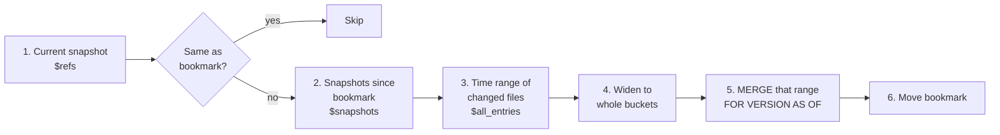
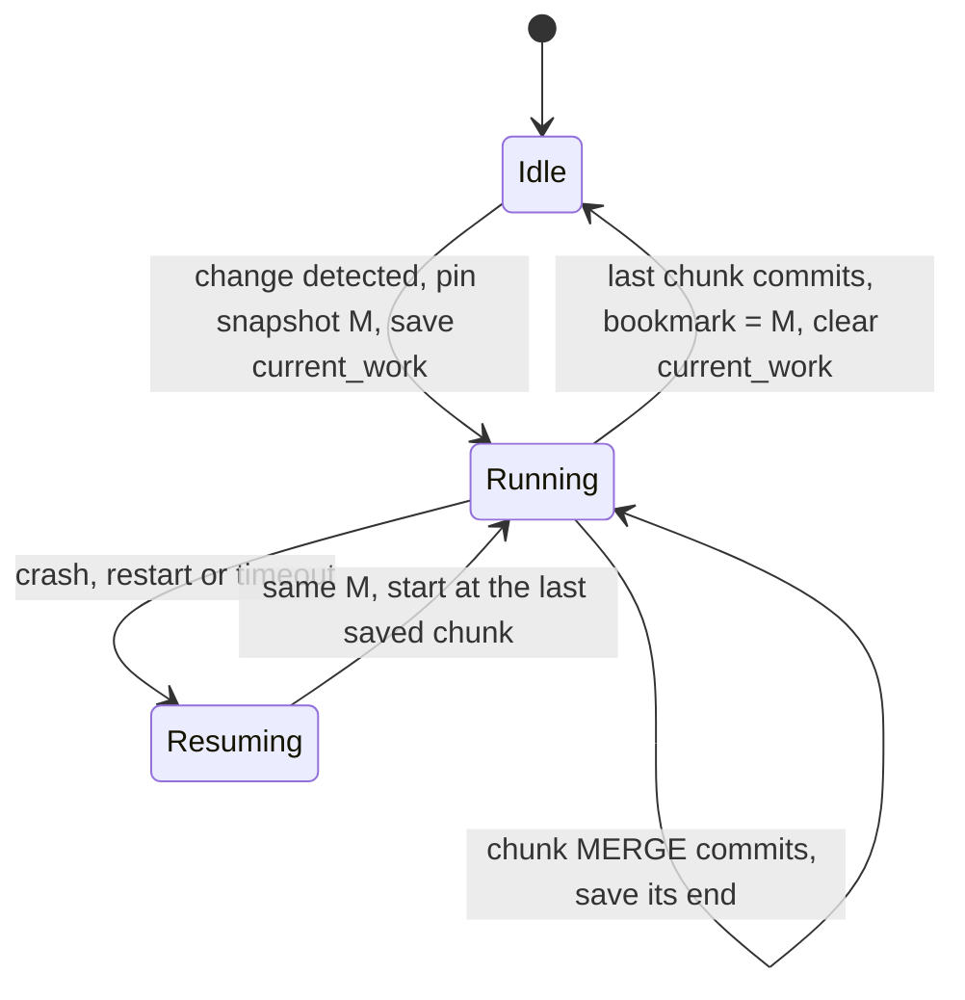

# How iceberg-ivm works

iceberg-ivm keeps an aggregating query's result in an Iceberg table, up to date as its source table changes. It never reads source data to find out what changed. It reads Iceberg metadata, works out which time buckets the new rows fall into, and has Trino recompute exactly those buckets from complete source data.

This page explains each step, the guarantees it gives, and the assumptions it relies on.

## The refresh cycle

Every view has its own worker. Every `refresh_interval_seconds` (or when you press Refresh), it runs one tick:



Steps 1–4 read only metadata. Step 5 is the only one that reads data, and it reads just the affected time range.

### 1. Has the source changed?

```sql
SELECT snapshot_id FROM iceberg.market_data."trades$refs" WHERE name = 'main'
```

The answer is the snapshot the source's `main` branch points at. iceberg-ivm stores, per view, the last snapshot it merged: the **bookmark**. If they match, the tick is a skip. Snapshots on other branches (for example write-audit-publish) are never read.

### 2. Which snapshots are new?

iceberg-ivm reads `snapshot_id, parent_id, operation` from `$snapshots` and walks the parent chain back from the current snapshot to the bookmark. That walk is the exact set of commits the view hasn't seen, in order. Each one is handled by its operation:

| Operation | Meaning | What the view does |
|---|---|---|
| `append` | rows added | recompute the buckets the new files cover |
| `overwrite` | rows rewritten, e.g. another view's `MERGE` | recompute the buckets the added and removed files cover |
| `replace` | compaction, no logical change | nothing |
| `delete`, anything else | rows removed, location unknown | full refresh |

If the walk never reaches the bookmark, the history the view relied on is gone: the table was replaced, rolled back past the bookmark, or an intermediate snapshot expired. The view then does a full refresh. An expired bookmark on its own is fine: its children still name it as their parent, and their manifests are what the next step reads.

### 3. What time range did they touch?

```sql
SELECT readable_metrics FROM iceberg.market_data."trades$all_entries"
WHERE snapshot_id IN (4815, 4821)      -- the append/overwrite snapshots
  AND status IN (1, 2)                 -- files added or removed
  AND data_file.content = 0            -- data files, not delete files
```

`readable_metrics` holds each file's min and max for every column. The view needs them for one column: the time column inside its `date_trunc`. The smallest min and largest max give the raw range of the change, for example `[10:15, 11:02]`.

A file can lack those bounds, for example when the writer was configured with `write.metadata.metrics.default=counts` or the table is wide enough to pass Iceberg's default limit on collected stats. iceberg-ivm never skips such a file: the change becomes "unbounded" and the view does a full refresh instead. If the full refresh can't find bounds on the live files either, the refresh fails with a clear error and the bookmark stays put, so no data is lost. Files whose values are all NULL are the one exception; they hold no rows a time bucket could contain.

### 4. Widen the range to whole buckets

`date_trunc` maps many timestamps to one bucket. Recomputing a bucket from only some of its rows would overwrite a correct aggregate with a wrong one. So the raw range is widened outward to bucket boundaries (`expand_to_bucket_bounds` in `detector.py`):

```text
raw range of new files:   [10:15, 11:02]
date_trunc('hour', ts):   [10:00, 12:00)    every row of both buckets is re-read
```

This works whatever the source's partitioning is. Weekly bars over a daily-partitioned source:

```text
Mon  100 volume                → weekly bar = 100
Tue  200 volume                → weekly bar = 300
Wed   50 volume arrives        → raw range is just Wednesday morning
widened to the week            → [Mon 00:00, next Mon 00:00)
MERGE reads Mon + Tue + Wed    → weekly bar = 350  (Wednesday alone would give 50)
```

The bounds are computed in Python and passed to Trino as literal timestamps. Iceberg can prune partitions and files on a plain `ts >= … AND ts < …` range; it can't on an expression like `date_trunc('week', ts) = …`.

### 5. Replace that range in the target

The view query is rewritten with that range and pinned to the snapshot the tick saw, then wrapped in one `MERGE`. For a minute-bars view the generated statement looks like this:

```sql
MERGE INTO iceberg.analytics.ohlcv_1m AS t
USING (
  SELECT IF(n."__ivm_new", n."minute", o."minute") AS "minute",
         IF(n."__ivm_new", n."symbol", o."symbol") AS "symbol",
         n."close", n."volume",
         n."__ivm_new" IS NULL AS "__ivm_gone"
  FROM (SELECT *, true AS "__ivm_new" FROM (
          -- your query, pinned and restricted to the range
          SELECT DATE_TRUNC('MINUTE', ts) AS minute, symbol,
                 MAX_BY(price, ts) AS close, SUM(qty) AS volume
          FROM iceberg.market_data.trades FOR VERSION AS OF 4821
          WHERE ts >= CAST('2026-04-09 10:00:00.000000 UTC' AS TIMESTAMP(6) WITH TIME ZONE)
            AND ts <  CAST('2026-04-09 16:00:00.000000 UTC' AS TIMESTAMP(6) WITH TIME ZONE)
          GROUP BY 1, 2
       )) AS n
  FULL OUTER JOIN (
    -- the keys the target already holds in that range
    SELECT "minute", "symbol" FROM iceberg.analytics.ohlcv_1m
    WHERE "minute" >= … AND "minute" < …
  ) AS o ON n."minute" = o."minute" AND n."symbol" IS NOT DISTINCT FROM o."symbol"
) AS s
ON t."minute" = s."minute" AND t."symbol" IS NOT DISTINCT FROM s."symbol"
WHEN MATCHED AND s."__ivm_gone" THEN DELETE
WHEN MATCHED THEN UPDATE SET "close" = s."close", "volume" = s."volume"
WHEN NOT MATCHED AND NOT s."__ivm_gone" THEN INSERT (…) VALUES (…)
```

After it commits, the target's rows in that range are exactly the query's result for that range:

- **New groups** are inserted, **changed groups** updated.
- **Groups that no longer exist are deleted.** These are keys the target holds in the range that the fresh result doesn't produce, for example a group that fell out of a `HAVING` clause.
- **NULL keys match NULL keys** (`IS NOT DISTINCT FROM`), so a NULL `symbol` is updated in place instead of inserted again. The bucket key uses plain `=`: it is never NULL inside a time range, and it gives Trino an equality to hash-join on.
- It is **one Iceberg commit**, so readers see the old range or the new one, never a mix.

Any aggregate works, including ones that can't be computed from partial results (`min_by`, `max_by`, `approx_percentile`, `count(DISTINCT …)`), because each bucket is recomputed from all of its source rows.

### 6. Move the bookmark

When every MERGE of the run has committed, the bookmark moves to the pinned snapshot. Commits that landed during the run are picked up on the next tick. If iceberg-ivm stops between the last MERGE and the bookmark write, the next tick merges the same range again, which changes nothing.

## Full refresh

A full refresh makes the whole target equal to the query. It runs when:

- the view has no bookmark: its first run, or after it was deleted and created again;
- a change can't be bounded: a `delete` snapshot, a broken ancestry, or files without stats.

Its window runs from the earliest to the latest of two ranges: the source's time range (from `$files` min/max) and the target's bucket range. Including the target's range matters. If the target holds rows the query no longer produces, for example from an older query that wrote to the same table, those buckets fall inside the window and the MERGE deletes them.

Before a forced full refresh starts, the bookmark is cleared. "No bookmark" always means "full refresh", so a restart in the middle resumes it correctly instead of treating it as incremental.

## Chunked, pinned, resumable runs

Recomputing years of history in one `MERGE` can exhaust Trino's memory. With `full_refresh_chunk: day` (or `week`, `month`…), a run is split into one MERGE per chunk, each committed on its own. This applies to incremental windows too, such as catching up after a long outage.



Three rules make this safe:

1. **One pinned snapshot.** Every chunk reads `FOR VERSION AS OF M`, so a run never mixes source states, even while new data keeps arriving.
2. **Progress saved after each commit.** `state.db` keeps `current_work`: the pinned snapshot M and the end of the last committed chunk. A resumed run reuses M as-is and doesn't re-detect, so its window can't drift.
3. **Resume re-merges the boundary chunk.** The resume point is floored to the start of the chunk containing it. Re-merging a chunk is idempotent, and this stays gap-free even if you changed the chunk size since the run began.

If M itself has expired by the time the run resumes, the run is discarded and the tick starts over with fresh detection.

The chunk must hold whole buckets of the view's granularity:

| View granularity | Allowed `full_refresh_chunk` |
|---|---|
| `millisecond`, `second`, `minute` | `minute`, `hour`, `day`, `week`, `month`, `quarter`, `year` |
| `hour` | `hour` and coarser |
| `day` | `day` and coarser |
| `week` | `week` only (weeks don't divide months) |
| `month` | `month`, `quarter`, `year` |
| `quarter` | `quarter`, `year` |
| `year` | `year` |

## What a view query can be

A view query is what you'd write after `CREATE MATERIALIZED VIEW … AS`: one `SELECT` over one Iceberg table, grouped by one `date_trunc` time bucket plus any other keys. iceberg-ivm derives everything else from it: source table, time column, bucket unit and merge keys.

✅ Accepted:

```sql
-- Bucket by position, any aggregates, a WHERE clause
SELECT date_trunc('minute', ts) AS minute, symbol,
       min_by(price, ts) AS open, max_by(price, ts) AS close
FROM iceberg.market_data.trades
WHERE venue = 'XNAS'
GROUP BY 1, 2

-- GROUP BY the expression itself, HAVING, a table alias
SELECT t.symbol, date_trunc('day', t.ts) AS day, count(*) AS trades
FROM iceberg.market_data.trades AS t
GROUP BY t.symbol, date_trunc('day', t.ts)
HAVING count(*) > 10

-- Chained: another view's target as the source
SELECT symbol, date_trunc('hour', minute) AS hour, sum(volume) AS volume
FROM iceberg.analytics.ohlcv_1m
GROUP BY 1, 2
```

❌ Rejected, with the reason:

```sql
-- No time bucket among the GROUP BY keys. Each refresh would overwrite
-- all-time totals with totals for just the new rows.
SELECT symbol, count(*) AS n FROM trades
WHERE date_trunc('day', ts) > DATE '2026-01-01'
GROUP BY symbol

-- Two time buckets: keep one
SELECT date_trunc('hour', ts) AS h, date_trunc('day', ts) AS d ... GROUP BY 1, 2

-- date_trunc must wrap a column directly
SELECT date_trunc('day', ts + INTERVAL '1' HOUR) AS d ... GROUP BY 1

-- Every computed column needs a name for the target table
SELECT date_trunc('day', ts) AS d, count(*) FROM trades GROUP BY 1
```

Also rejected: joins, subqueries, CTEs, `UNION`/`INTERSECT`/`EXCEPT`, `SELECT *`, `GROUP BY ALL`/`ROLLUP`/`CUBE`/`GROUPING SETS`, and your own `FOR VERSION AS OF` (iceberg-ivm pins the snapshot itself). Supported bucket units: `millisecond`, `second`, `minute`, `hour`, `day`, `week`, `month`, `quarter`, `year`.

## The target table

On the first refresh that has work to do, iceberg-ivm asks Trino for the query's output columns without running it (`PREPARE` + `DESCRIBE OUTPUT`) and creates the target with `CREATE TABLE IF NOT EXISTS … WITH (format = 'PARQUET')`. It is unpartitioned unless you set `target_partitioning`. For a large target, partition it by the bucket column, for example `ARRAY['day(minute)']`: every MERGE reads the target's rows in its range, and partitioning keeps that read small.

Merge keys are the GROUP BY keys, and every other output column is updated in place. Because the target is a normal Iceberg table, any engine can read it, and it can be the source of another view.

If `maintenance_interval_seconds` is above 0, the worker also runs `ALTER TABLE … EXECUTE optimize`, `expire_snapshots` and `remove_orphan_files` on the target after a tick, at most once per interval. Running it in the same worker as refreshes avoids commit conflicts with the view's own MERGEs.

## Time zones

Every Trino session iceberg-ivm opens is pinned to UTC. Bucket boundaries are computed in UTC for `TIMESTAMP WITH TIME ZONE` columns, and in plain wall-clock time for `TIMESTAMP` columns. Pinning the session keeps Trino's `date_trunc` on the same boundaries as the range iceberg-ivm computes. If they disagreed, a day bucket in New York time would straddle two UTC days and be recomputed from a partial range.

## State

All state lives in one SQLite file, `state.db`, next to `views.yaml` by default:

| Table | Holds |
|---|---|
| `view_status` | per view: the bookmark, `current_work` (pinned snapshot + last committed chunk), and the counters the UI shows |
| `query_history` | the last 50 Trino queries per view, with links to the Trino UI |
| `maintenance_state` | when each maintenance op last ran, so restarts keep the schedule |

Deleting a view through the API or UI removes its rows, so a view created again under the same name starts with a full refresh. The target table is left as it is.

## Assumptions and limitations

- **The time column needs min/max statistics.** Iceberg writers collect them by default, but only for a table's first 100 columns unless configured otherwise. Set `write.metadata.metrics.column.<col>=full` if your time column is beyond that.
- **Row-level updates must not move a row to another time bucket.** With merge-on-read, a deleted row is recorded as a position-delete file, which carries no time bounds. iceberg-ivm recomputes the buckets of the rewritten rows, so an update that changes a row's timestamp leaves its old bucket stale. Updates that keep the timestamp, including other views' MERGEs, are handled.
- **Deletes cost a full refresh.** That is correct but can be expensive on a large source. Set `full_refresh_chunk` so it runs in resumable pieces.
- **Avoid `LIMIT` and window functions (`OVER`) in view queries.** They aren't rejected yet, but they are evaluated per refreshed range, not over the whole table, so their results would be wrong.
- **Don't drop the target table by hand.** The bookmark would still point past data the new, empty table never received. Delete the view and create it again to rebuild.
- **Run one instance per set of views.** Two instances refreshing the same view would run conflicting MERGEs.
- **The UI and API have no authentication unless you set `IVM_PASSWORD`.** It enables HTTP Basic auth on everything except `/health` and `/metrics`.

## Design choices

**MERGE, not DELETE + INSERT.** Trino has no multi-statement transactions on Iceberg, so a DELETE and an INSERT are two commits, and readers in between would see missing rows. One MERGE is one commit. The full outer join with the target's existing keys gives it the delete half as well.

**File statistics, not partition diffs.** Diffing partitions finds the changed partitions, but a view's buckets needn't line up with them. A weekly bucket over daily partitions needs the whole week, not the changed day. File-level min/max gives the real time range of the new rows whatever the partitioning, and bucket widening does the rest.

**Bucket math in Python.** The widened range goes to Trino as literal bounds, which Iceberg can use to prune partitions and files. A `date_trunc(...)` predicate generally can't be pruned on.

**Change detection by ancestry, not timestamps.** Following `parent_id` from the `main` ref is exact. Sorting snapshots by commit time would mix in other branches, misread rollbacks, and need tie-breaks for equal timestamps.

**SQLite for state.** The bookmark, in-flight run, query history and maintenance schedule share one key (the view) and one access pattern. A local file needs no extra service and no write access to the Iceberg catalog. A MERGE and the bookmark write can't share a transaction, so the order is chosen to make a crash between them harmless: MERGE first, then the bookmark.

**Column discovery with `DESCRIBE OUTPUT`.** Trino reports the query's exact output names and types without running it, so you never declare columns or types yourself.
